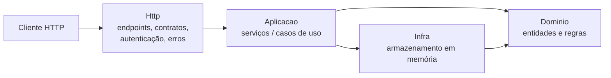

# Arquitetura da Loja

Uma API pequena de propósito: dá para ler inteira em 15 minutos. O que importa aqui não é o tamanho, é que **cada coisa tem um lugar**, e o agente sabe qual é.

## Camadas

| Pasta | Responsabilidade | Pode depender de | Não pode |
|---|---|---|---|
| `Dominio/` | Entidades e **todas** as regras de negócio | nada | conhecer HTTP, serviços ou armazenamento |
| `Aplicacao/` | Orquestrar um caso de uso: buscar, chamar o domínio, salvar | Dominio, Infra | conter regra de negócio |
| `Infra/` | Guardar e buscar dados (hoje em memória) | Dominio | conter regra de negócio |
| `Http/` | Receber requisição, identificar cliente, devolver contrato, traduzir erro | Aplicacao, Dominio | conter regra de negócio ou expor entidade |

**Teste rápido para saber onde uma linha nova vai:** se a linha decide *se algo é permitido* ou *quanto algo custa*, ela é regra e vai para `Dominio/`.

## Caminho de uma requisição

`POST /carrinho/itens` com `{ "produtoId": 1, "quantidade": 2 }` e o cabeçalho `X-Cliente-Id: ana`:

1. **Http**: o filtro `ExigirCliente()` lê o cabeçalho (sem ele: 401). O endpoint chama `CarrinhoServico.AdicionarItem("ana", 1, 2)`.
2. **Aplicacao**: o serviço busca o produto no catálogo (inexistente: 404) e o carrinho da Ana.
3. **Dominio**: `Carrinho.AdicionarItem` aplica as regras: quantidade positiva, limite por item, estoque. Regra violada lança `RegraDeNegocioException`.
4. **Http**: o endpoint converte o carrinho em `CarrinhoResposta`. Se houve exceção, o `TratadorDeErros` a converte em ProblemDetails (422 com `codigo`, ou 404).

## Decisões e o porquê

**Erros como exceções de domínio, traduzidos num lugar só.** O domínio não sabe o que é HTTP; ele lança `RegraDeNegocioException("limite-por-item", ...)`. O `TratadorDeErros` transforma isso em 422. O código do erro é estável: front-end e testes dependem dele.

**Autorização por recurso no serviço.** Estar identificado não basta. `PedidoServico.ObterDoCliente` só devolve o pedido se ele for do cliente; se não for, responde 404, igual a um pedido inexistente, para não revelar que o pedido existe. Toda feature nova que expõe recurso de cliente segue esse modelo.

**Autenticação simulada por cabeçalho.** `X-Cliente-Id` substitui um token de verdade só para o kit rodar sem servidor de identidade. Num sistema real o id do cliente viria de um JWT validado (claim `sub`). O resto do código já está escrito como se fosse assim: o id sai de `http.ClienteId()`, nunca do corpo da requisição.

**Armazenamento em memória.** Sem banco, sem Docker, sem connection string. Os dados somem quando a API reinicia. Num projeto real, `Infra/` teria EF Core e os serviços não mudariam.

**Relógio injetado.** `TimeProvider` registrado no container. Qualquer regra que dependa de data usa o relógio injetado, para que testes possam controlar o "agora".

**Preço congelado no item.** O item do carrinho guarda o preço vigente e se o produto estava em promoção no momento em que foi adicionado. Regras de desconto costumam depender disso.

## Dados de exemplo (catálogo)

| Id | Produto | Preço | Promoção | Estoque |
|---|---|---|---|---|
| 1 | Teclado mecânico | 349,90 | não | 20 |
| 2 | Mouse sem fio | 129,90 | 99,90 | 50 |
| 3 | Monitor 27" | 1.899,00 | não | 5 |
| 4 | Headset | 459,00 | 389,00 | 15 |
| 5 | Webcam Full HD | 279,90 | não | 0 |
